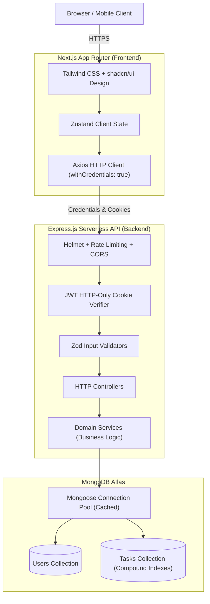

# TaskFlow — Enterprise SaaS Task Management System


A production-grade, full-stack Task Management SaaS platform engineered for the **MERN Stack Developer Technical Assessment** at **Hammoq Infosystems**.

Built with clean architecture, strict TypeScript validation, real MongoDB aggregation pipelines, compound indexes, secure HTTP-only cookie sessions, and an enterprise-grade UI matching modern SaaS design systems.

---

## Table of Contents

1. [Architectural Overview](#1-architectural-overview)
2. [Key Features](#2-key-features)
3. [Technology Stack](#3-technology-stack)
4. [Monorepo Directory Structure](#4-monorepo-directory-structure)
5. [Database Schema & Index Design](#5-database-schema--index-design)
6. [API Documentation](#6-api-documentation)
7. [Security & Ownership Model](#7-security--ownership-model)
8. [Local Development & Setup](#8-local-development--setup)
9. [Automated Testing & Quality Assurance](#9-automated-testing--quality-assurance)
10. [Vercel & Production Deployment](#10-vercel--production-deployment)
11. [Assessment Deliverables (Talking Points & Trade-offs)](#11-assessment-deliverables)

---

## 1. Architectural Overview

TaskFlow follows a decoupled **Monorepo Architecture** separating the Next.js App Router frontend from the Express.js backend API, enabling independent scaling while preserving single-repository governance.



### Core Architecture Highlights
- **Strict Separation of Concerns**: Controllers only handle HTTP status codes and responses. All domain rules, ownership checks, and query transformations reside in domain services (`AuthService`, `TaskService`, `DashboardService`).
- **Connection Caching for Serverless**: Database connection pooling is cached on the Node global object, preventing socket exhaustion on Vercel serverless cold starts.
- **Fail-Safe Authorization**: Frontend user IDs are never trusted for ownership authorization; authorization is strictly derived from the verified JWT payload.

---

## 2. Key Features

### Authentication & Session Security
- User registration with name, email, and password.
- Duplicate email conflict rejection (`409 Conflict`).
- Cryptographic password hashing using `bcryptjs` (salt rounds: 12).
- Zero password leakage: password fields use `select: false` at the schema level and DTO pruning.
- Stateless JWT issuance stored inside **HTTP-only, Secure, SameSite cookies** (with automatic fallback to `Authorization: Bearer` headers for API/test automation).
- Route guards and centralized session validation.

### Task Management & Productivity
- Complete CRUD operations for tasks (Title, Description, Status, Priority, Due Date).
- Workflow states: `TODO`, `IN_PROGRESS`, `COMPLETED`.
- Priority levels: `LOW`, `MEDIUM`, `HIGH`.
- Dynamic full-text regex searching across titles and descriptions.
- Multi-parameter filtering by status and priority.
- Multi-attribute sorting (Due Date, Creation Date, Title, Priority).
- Server-side pagination with metadata (`page`, `limit`, `total`, `totalPages`, `hasNextPage`, `hasPrevPage`).
- Overdue milestone detection (`dueDate < now && status !== 'COMPLETED'`).
- Interactive View Switcher: High-density **Table View** and Agile **Kanban Board**.

### Executive Analytics Dashboard
- MongoDB `$facet` aggregation computing real-time task metrics:
  - Total tasks
  - Completed tasks
  - Pending tasks
  - In-progress tasks
  - Overdue tasks
  - Completion percentage
- **Task Status Distribution**: Circular donut visualization powered by Recharts with center completion metric.
- **Monthly Review Activity**: Stacked purple bar charts reflecting throughput.
- **Upcoming Deadlines**: Real-time deliverable countdown widget.
- **Recent Task Activity**: High-density activity table.

---

## 3. Technology Stack

| Layer | Technologies |
| :--- | :--- |
| **Frontend** | Next.js 14 (App Router), React 18, TypeScript, Tailwind CSS, Lucide React, Zustand, Axios, React Hook Form, Zod, Recharts, date-fns |
| **Backend** | Node.js, Express.js, TypeScript, Mongoose ODM, JWT, bcryptjs, Zod, Cookie-Parser, Helmet, Express-Rate-Limit, CORS |
| **Database** | MongoDB Atlas / MongoDB 8.x with compound indexes |
| **Testing** | Jest, Supertest, ts-jest, MongoMemoryServer |
| **Deployment** | Vercel (Frontend & Serverless Express Backend), MongoDB Atlas |

---

## 4. Monorepo Directory Structure

```
taskflow/
├── backend/
│   ├── api/
│   │   └── index.ts               # Vercel serverless handler with cached DB init
│   ├── src/
│   │   ├── config/                # Mongoose connection & Zod-validated env
│   │   ├── controllers/           # HTTP request/response handlers
│   │   ├── middleware/            # Auth, Zod validation, error handler, rate limit
│   │   ├── models/                # Mongoose schemas & indexes
│   │   ├── routes/                # Express router mounts (/api/v1)
│   │   ├── services/              # Domain logic & MongoDB aggregations
│   │   ├── validators/            # Zod validation schemas
│   │   ├── utils/                 # ApiResponse, AppError, JWT & Cookie helpers
│   │   ├── types/                 # TypeScript interfaces
│   │   ├── app.ts                 # Express application configuration
│   │   └── server.ts              # Local standalone HTTP server
│   ├── tests/                     # 24 Jest + Supertest integration tests
│   ├── .env.example
│   ├── vercel.json                # Vercel serverless configuration
│   ├── tsconfig.json
│   └── package.json
│
├── frontend/
│   ├── public/                    # Static assets
│   ├── src/
│   │   ├── app/
│   │   │   ├── (auth)/            # Auth route group (login, register)
│   │   │   ├── (dashboard)/       # Dashboard route group (dashboard, tasks, settings)
│   │   │   ├── globals.css        # Tailwind styles & theme variables
│   │   │   ├── layout.tsx         # Root layout with ToastProvider
│   │   │   └── page.tsx           # SaaS Landing & welcome portal
│   │   ├── components/
│   │   │   ├── ui/                # Button, Input, Textarea, Badge, Dialog, Toast, Skeleton
│   │   │   ├── layout/            # Sidebar, TopNavbar, MobileNav
│   │   │   ├── dashboard/         # StatCards, ActivityChart, StatusChart, RecentTasks
│   │   │   ├── tasks/             # TaskTable, TaskKanban, TaskFilters, TaskModal, DeleteDialog
│   │   │   └── forms/             # LoginForm, RegisterForm
│   │   ├── lib/                   # Axios client instance & cn utility
│   │   ├── services/              # Client API services (auth, task, dashboard)
│   │   ├── store/                 # Zustand global stores (authStore, taskStore)
│   │   └── types/                 # Frontend TypeScript interfaces
│   ├── .env.example
│   ├── tailwind.config.ts
│   ├── tsconfig.json
│   └── package.json
│
├── README.md
├── .gitignore
└── package.json                   # Root monorepo workspace scripts
```

---

## 5. Database Schema & Index Design

### Users Collection (`users`)
```typescript
{
  _id: ObjectId,
  name: String (required, min: 2, max: 50, trim: true),
  email: String (required, unique: true, lowercase: true, index: true),
  password: String (required, min: 6, select: false),
  createdAt: Date,
  updatedAt: Date
}
```

### Tasks Collection (`tasks`)
```typescript
{
  _id: ObjectId,
  title: String (required, max: 120, trim: true),
  description: String (max: 1000, trim: true, default: ""),
  status: String (enum: ["TODO", "IN_PROGRESS", "COMPLETED"], default: "TODO"),
  priority: String (enum: ["LOW", "MEDIUM", "HIGH"], default: "MEDIUM"),
  dueDate: Date (required),
  userId: ObjectId (ref: "User", required, index: true),
  createdAt: Date,
  updatedAt: Date
}
```

### Strategic Compound Indexes
To ensure sub-millisecond query performance as dataset scales:
- `{ userId: 1, status: 1 }`: Optimized for status-filtered queries and kanban lanes.
- `{ userId: 1, dueDate: 1 }`: Optimized for overdue detection and upcoming deadlines.
- `{ userId: 1, priority: 1 }`: Optimized for priority filtering.
- `{ userId: 1, createdAt: -1 }`: Optimized for recent tasks and chronologically sorted pagination.

---

## 6. API Documentation

Base URL: `/api/v1`

### Authentication Endpoints

#### 1. Register User
- **Method / Endpoint**: `POST /auth/register`
- **Request Body**:
  ```json
  {
    "name": "Alex Johnson",
    "email": "alex@taskflow.dev",
    "password": "Password123!"
  }
  ```
- **Response** (`201 Created`):
  ```json
  {
    "success": true,
    "message": "Account registered successfully",
    "data": {
      "user": {
        "id": "67399bf0a41d9990ec31c511",
        "email": "alex@taskflow.dev",
        "name": "Alex Johnson"
      },
      "token": "eyJhbGciOi..."
    }
  }
  ```
  *Sets HTTP-only cookie `token`.*

#### 2. Login User
- **Method / Endpoint**: `POST /auth/login`
- **Request Body**:
  ```json
  {
    "email": "alex@taskflow.dev",
    "password": "Password123!"
  }
  ```
- **Response** (`200 OK`):
  ```json
  {
    "success": true,
    "message": "Logged in successfully",
    "data": {
      "user": { "id": "67399bf...", "email": "alex@taskflow.dev", "name": "Alex Johnson" },
      "token": "eyJhbGciOi..."
    }
  }
  ```

#### 3. Current Authenticated Profile
- **Method / Endpoint**: `GET /auth/me`
- **Response** (`200 OK`):
  ```json
  {
    "success": true,
    "message": "Profile retrieved successfully",
    "data": {
      "user": { "id": "67399bf...", "email": "alex@taskflow.dev", "name": "Alex Johnson" }
    }
  }
  ```

#### 4. Logout
- **Method / Endpoint**: `POST /auth/logout`
- **Response** (`200 OK`): Clears `token` cookie.

---

### Task Endpoints (Protected)

#### 1. Create Task
- **Method / Endpoint**: `POST /tasks`
- **Request Body**:
  ```json
  {
    "title": "Build MongoDB Aggregation Pipeline",
    "description": "Compute status and priority metrics",
    "status": "IN_PROGRESS",
    "priority": "HIGH",
    "dueDate": "2026-12-01T00:00:00.000Z"
  }
  ```
- **Response** (`201 Created`): Returns created task object with `isOverdue` calculation.

#### 2. Get Tasks (Filter, Search, Sort, Paginate)
- **Method / Endpoint**: `GET /tasks?page=1&limit=10&status=IN_PROGRESS&priority=HIGH&search=pipeline&sortBy=dueDate&sortOrder=asc`
- **Response** (`200 OK`):
  ```json
  {
    "success": true,
    "message": "Tasks retrieved successfully",
    "data": [
      {
        "_id": "6739a...",
        "title": "Build MongoDB Aggregation Pipeline",
        "description": "Compute status and priority metrics",
        "status": "IN_PROGRESS",
        "priority": "HIGH",
        "dueDate": "2026-12-01T00:00:00.000Z",
        "userId": "67399bf...",
        "isOverdue": false,
        "createdAt": "2026-11-17T13:58:00.000Z",
        "updatedAt": "2026-11-17T13:58:00.000Z"
      }
    ],
    "pagination": {
      "page": 1,
      "limit": 10,
      "total": 1,
      "totalPages": 1,
      "hasNextPage": false,
      "hasPrevPage": false
    }
  }
  ```

#### 3. Update Task
- **Method / Endpoint**: `PATCH /tasks/:id`
- **Response** (`200 OK`): Returns updated task.

#### 4. Update Task Status
- **Method / Endpoint**: `PATCH /tasks/:id/status`
- **Request Body**: `{ "status": "COMPLETED" }`

#### 5. Delete Task
- **Method / Endpoint**: `DELETE /tasks/:id`
- **Response** (`200 OK`): `{ "success": true, "message": "Task deleted successfully" }`

---

### Dashboard Endpoints (Protected)

#### 1. Aggregate Statistics
- **Method / Endpoint**: `GET /dashboard/stats`
- **Response** (`200 OK`):
  ```json
  {
    "success": true,
    "message": "Dashboard statistics retrieved successfully",
    "data": {
      "totalTasks": 12,
      "completedTasks": 8,
      "pendingTasks": 2,
      "inProgressTasks": 2,
      "overdueTasks": 1,
      "completionRate": 67,
      "statusDistribution": [
        { "status": "TODO", "count": 2, "percentage": 17 },
        { "status": "IN_PROGRESS", "count": 2, "percentage": 17 },
        { "status": "COMPLETED", "count": 8, "percentage": 67 }
      ],
      "priorityDistribution": [
        { "priority": "LOW", "count": 3, "percentage": 25 },
        { "priority": "MEDIUM", "count": 5, "percentage": 42 },
        { "priority": "HIGH", "count": 4, "percentage": 33 }
      ]
    }
  }
  ```

#### 2. Recent Tasks
- **Method / Endpoint**: `GET /dashboard/recent-tasks?limit=5`

#### 3. Upcoming Deadlines
- **Method / Endpoint**: `GET /dashboard/upcoming-tasks?limit=5`

---

## 7. Security & Ownership Model

1. **HTTP-Only Cookies**: JWT tokens are transmitted via `httpOnly: true` cookies, mitigating cross-site scripting (XSS) attack surfaces by blocking JavaScript access in browser context.
2. **Cross-Site Request Forgery & CORS**: CORS allowlist strictly enforces origins and credentials (`credentials: true`, specific methods, and origin validation).
3. **Strict Ownership Scoping**: Every database query (`find`, `findOne`, `findOneAndUpdate`, `findOneAndDelete`, `countDocuments`, `aggregate`) unconditionally filters by `userId` retrieved from the verified token. Attempting to query an ID belonging to another user returns a clean `404 Not Found` to prevent resource enumeration attacks.
4. **Input Sanitization**: All incoming data is rigorously parsed with Zod schemas. Regex search characters are escaped to prevent ReDoS (Regular Expression Denial of Service).
5. **Rate Limiting**: Authentication endpoints are rate-limited (`20` attempts per 15 minutes), preventing brute-force password spraying attacks.
6. **Security Headers**: `helmet()` provides standard CSP, HSTS, frameguard, and content-type protections.

---

## 8. Local Development & Setup

### Prerequisites
- Node.js `v18.x` or higher (tested on `v22.x`)
- npm `v9.x` or higher
- MongoDB instance (MongoDB Atlas URI or local `mongodb://127.0.0.1:27017/taskflow`)

### Step 1: Clone Repository & Install Dependencies
```bash
git clone <repository-url>
cd taskflow

# Install backend dependencies
cd backend
npm install

# Install frontend dependencies
cd ../frontend
npm install

# Return to root
cd ..
```

### Step 2: Configure Environment Variables

**Backend (`backend/.env`):**
```env
NODE_ENV=development
PORT=5000
MONGODB_URI=mongodb+srv://<username>:<password>@cluster0.mongodb.net/taskflow?retryWrites=true&w=majority
JWT_SECRET=supersecretjwtkey_taskflow_minimum_32_characters_long_for_security
JWT_EXPIRES_IN=7d
FRONTEND_URL=http://localhost:3000
```

**Frontend (`frontend/.env.local`):**
```env
NEXT_PUBLIC_API_URL=http://localhost:5000/api/v1
```

### Step 3: Run Development Servers
From root workspace:
```bash
# Terminal 1: Run Backend
npm run dev:backend

# Terminal 2: Run Frontend
npm run dev:frontend
```

The applications will be accessible at:
- **Frontend Web App**: `http://localhost:3000`
- **Backend API**: `http://localhost:5000/api/v1`
- **Health Check**: `http://localhost:5000/api/v1/health`

---

## 9. Automated Testing & Quality Assurance

TaskFlow includes an exhaustive automated integration test suite built with **Jest**, **Supertest**, and **MongoMemoryServer** for complete offline execution.

To execute tests:
```bash
cd backend
npm test
```

### Test Suite Execution Output
```
PASS tests/task.test.ts
  Task & Dashboard API Suite
    POST /api/v1/tasks (Create Task)
      ✓ should create a task successfully with valid data
      ✓ should reject task creation with missing title
      ✓ should reject unauthorized creation attempt without token
    GET /api/v1/tasks & Search, Filter, Pagination
      ✓ should list only User A tasks with pagination metadata
      ✓ should filter tasks by status
      ✓ should filter tasks by priority
      ✓ should search tasks by keyword in title or description
    Task Details, Updates & Cross-User Security
      ✓ should allow User A to retrieve their own task
      ✓ should REJECT User B attempting to view User A task
      ✓ should allow User A to update task fields
      ✓ should update task status via dedicated status endpoint
      ✓ should REJECT User B attempting to delete User A task
      ✓ should allow User A to delete their own task
    Dashboard Analytics (/api/v1/dashboard/stats)
      ✓ should aggregate dashboard metrics accurately from MongoDB
      ✓ should return recent tasks and upcoming deadlines

PASS tests/auth.test.ts
  Authentication API Suite
    POST /api/v1/auth/register
      ✓ should register a new user successfully and return cookie
      ✓ should reject registration when email already exists
      ✓ should validate invalid registration fields
    POST /api/v1/auth/login
      ✓ should log in successfully with valid credentials
      ✓ should reject login with wrong password
      ✓ should reject login for non-existent email
    GET /api/v1/auth/me
      ✓ should reject unauthorized requests without token
      ✓ should return profile for authenticated user via cookie or Bearer token
    POST /api/v1/auth/logout
      ✓ should clear authentication cookie on logout

Test Suites: 2 passed, 2 total
Tests:       24 passed, 24 total
Time:        16.295 s
```

---

## 10. Vercel & Production Deployment

### 1. Backend Serverless Deployment on Vercel
The backend includes a dedicated serverless entry point at `backend/api/index.ts` with cached database connection handling and `backend/vercel.json`:

```json
{
  "version": 2,
  "builds": [{ "src": "api/index.ts", "use": "@vercel/node" }],
  "routes": [{ "src": "/(.*)", "dest": "api/index.ts" }]
}
```

**Steps to deploy backend:**
1. Import the `backend/` directory in Vercel as a new project.
2. In Vercel Project Settings > Environment Variables, configure:
   - `NODE_ENV=production`
   - `MONGODB_URI=<your_mongodb_atlas_connection_string>`
   - `JWT_SECRET=<strong_production_secret>`
   - `JWT_EXPIRES_IN=7d`
   - `FRONTEND_URL=<your_frontend_vercel_domain>`
3. Deploy. Your API will be live at `https://<backend-project>.vercel.app/api/v1`.

### 2. Frontend Next.js Deployment on Vercel
1. Import the `frontend/` directory in Vercel.
2. Configure Environment Variable:
   - `NEXT_PUBLIC_API_URL=https://<backend-project>.vercel.app/api/v1`
3. Deploy. Next.js App Router will optimize and render static and dynamic routes.

---

## 11. Assessment Deliverables

### Deliverable 1: Working Application and Source Code
- **Repository**: Single GitHub monorepo with clean separation (`frontend/` and `backend/`).
- **Setup Guide**: See [Local Development & Setup](#8-local-development--setup).
- **Verified Builds**:
  - `npm run build:backend` -> Compiles TypeScript to `dist/` with 0 warnings.
  - `npm run build:frontend` -> Compiles Next.js 14 App Router static & server pages with 0 warnings.
  - `npm run test:backend` -> 24/24 integration tests passing.

---

### Deliverable 2: Video Explanation Talking Points

#### Decision 1: Why this architecture was selected
- **Monorepo with Dedicated Front/Back Separation**: Avoided tightly-coupling Express inside Next.js API routes. By separating the Node/Express backend from the Next.js App Router frontend, both systems maintain pure separation of concerns. Express manages its own middleware pipeline (Helmet, rate limiting, cookie parsing, CORS) and service layer, while Next.js handles server components, client interactivity, and responsive rendering.
- **Service-Controller Layering**: Controllers exclusively handle HTTP requests, status codes, and input/output formatting. Reusable business rules and MongoDB interactions reside in dedicated services (`AuthService`, `TaskService`, `DashboardService`), adhering to the Single Responsibility Principle and facilitating testability.
- **Serverless Connection Reuse**: Prepared for Vercel serverless execution through a global connection caching pattern in `backend/src/config/db.ts` to prevent Mongoose connection leaks during cold starts.

#### Decision 2: Why this database schema and ownership model were selected
- **Direct User-Task Ownership**: Every task document stores a `userId` reference to its creator. All queries (`Task.find({ userId, ... })`, `Task.findOne({ _id, userId })`, `Task.findOneAndUpdate({ _id, userId })`) enforce user boundaries at the database level. Even if a malicious user alters an ID parameter, the query returns `404 Not Found`, ensuring zero cross-tenant data leakage.
- **Targeted Compound Indexing**: Selected compound indexes (`userId + status`, `userId + dueDate`, `userId + priority`, `userId + createdAt`) to match the exact access patterns of the TaskFlow dashboard, search filters, and overdue calculations, eliminating in-memory sorting overhead in MongoDB.
- **MongoDB Aggregation Pipeline**: Designed a `$facet` pipeline in `DashboardService.getStats()` that computes status distributions, priority breakdowns, total counts, and overdue metrics in a single network round-trip to MongoDB Atlas.

#### Decision 3: Why authentication and security were implemented this way
- **HTTP-Only Cookies Over LocalStorage**: Storing JWT tokens in `localStorage` makes applications vulnerable to token theft via Cross-Site Scripting (XSS). Storing the token in an `httpOnly`, `secure`, and `sameSite` cookie makes it inaccessible to client JavaScript.
- **Dual Verification Path**: To support both seamless browser experiences (via cookies) and programmatic API testing / CI test runners (via `Authorization: Bearer`), the auth middleware inspects both cookies and authorization headers.
- **Password Protection**: Implemented pre-save password hashing with `bcryptjs` using 12 salt rounds, paired with `select: false` on the User model to guarantee password hashes are never accidentally included in queries or serialized JSON responses.

---

### Deliverable 3: Three Features Not Implemented (Out-of-Scope & Trade-offs)

1. **Real-Time WebSockets / Server-Sent Events (SSE) for Collaborative Multi-User Editing**:
   - *Reason for Omission*: Real-time bidirectional WebSockets require a persistent stateful server process (e.g., dedicated Node cluster or Socket.io gateway), which conflicts with Vercel's serverless stateless execution model where functions freeze after request completion.
   - *Trade-off*: Implemented optimistic client-side UI updates in Zustand combined with lightweight polling/refetching on user actions, delivering an instant UI experience without requiring third-party WebSocket infrastructure (e.g., Pusher or Redis Pub/Sub).

2. **Team Multi-Tenancy & Role-Based Access Control (RBAC - Owner, Admin, Editor, Viewer)**:
   - *Reason for Omission*: The assessment scope explicitly focused on personal/developer task workflows and single-user ownership models. Adding organization workspaces, member invitations, and granular permission matrices would introduce unnecessary schema complexity at this stage.
   - *Trade-off*: Designed the `Task` schema with an extensible `userId` reference that can seamlessly migrate to an `organizationId` or `teamId` compound key in future releases.

3. **Direct File Attachments & Asset Uploads (e.g., S3 / Cloudinary)**:
   - *Reason for Omission*: Handling large binary files directly through Express adds latency and memory overhead, requiring cloud object storage (AWS S3, Google Cloud Storage, or Cloudinary) with signed upload URLs and external API keys.
   - *Trade-off*: Focused development time on perfecting core task management, data validation, sub-millisecond query performance, and analytics visualizations.

---

### Deliverable 4: One Real Implementation Limitation & Additional Development Day Solution

- **The Limitation**: **Regex-Based Search Scalability on Large Datasets**.
  - In `TaskService.getTasks`, text searching across task titles and descriptions currently uses case-insensitive regular expressions (`$regex: sanitized, $options: 'i'`). While regex search with special character sanitization works for tens of thousands of tasks per user, MongoDB cannot effectively utilize B-tree indexes for unanchored regex queries (`.*term.*`), leading to collection scans for large task counts.
- **How an Additional Development Day Would Address It**:
  1. **MongoDB Atlas Search (Lucene Engine)**: Provision an Atlas Search Index mapping `title` and `description` with ngram or autocomplete analyzers to provide typo-tolerant, relevancy-ranked search in `<10ms`.
  2. **Compound Text Indexes**: Alternatively, configure a native compound MongoDB text index:
     ```typescript
     TaskSchema.index({ title: 'text', description: 'text' }, { weights: { title: 10, description: 3 } });
     ```
  3. **Debounced Search Service**: Refactor the backend service query to use `$text: { $search: query }` with score-based sorting for search precision.
